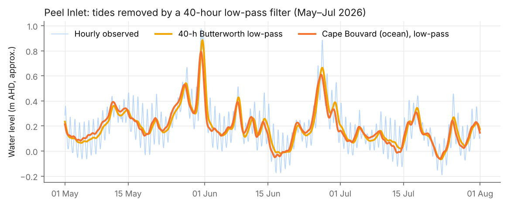
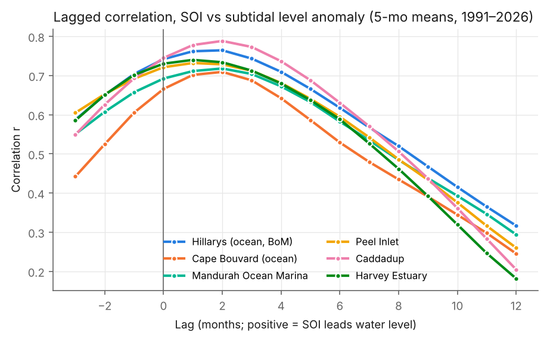
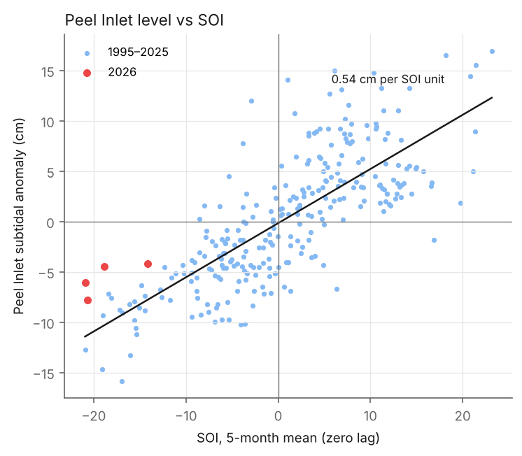

*Water level analysis · data to Sep–Oct 2026*

# Peel-Harvey low water levels in 2026 and the Southern Oscillation Index

*Department of Transport WA tide gauges, BoM Hillarys and the BoM SOI, 1991–2026*

**Low water levels in the Peel-Harvey Estuary during winter 2026 were driven by the coastal ocean and matched the strongly negative Southern Oscillation Index (SOI).** After tides were filtered out and the long-term trend removed, mean levels from June to September 2026 were 7–9 cm below normal at all estuary gauges. These were among the four lowest winters in 32–39 years of record, and the lowest at Harvey.

The low levels followed a well-established relationship. Between 1991 and 2026, subtidal levels at every estuary and ocean gauge rose and fell with the SOI (r = 0.71–0.79 for 5-month means), and the SOI led water level by about two months. In contrast, the difference between estuary and ocean levels was small and unrelated to the SOI. The ENSO signal therefore reached the estuary from the coastal ocean through the Mandurah Channel and Dawesville Cut, consistent with changes in the Leeuwin Current.

## Approach

The analysis used water levels from five Department of Transport (DoT) gauges in and next to the estuary, referenced to two ocean gauges. The estuary gauges were Mandurah, Peel Inlet, Caddadup and Harvey; Cape Bouvard, just south of the Dawesville Cut, provided the local ocean level. Fremantle (DoT) and Hillarys (BoM) were the regional ocean references. Tides were removed with a 40-hour low-pass Butterworth filter, and the filtered records were averaged by month. Monthly anomalies were then calculated against the 1996–2025 seasonal cycle, which follows the opening of the Dawesville Cut in 1994, and a linear trend fitted over the same period was removed. Finally, the anomalies were correlated with the monthly SOI at lags of −3 to +12 months. Before the analysis, datum changes in the gauge records were identified and corrected. These corrections, the filter design and the statistics are described in the Supplementary material.

## Results

### Estuary and ocean levels moved together

Subtidal levels in the estuary closely tracked the coastal ocean on all timescales from days to years. On short timescales, storm surges at Cape Bouvard appeared at Peel Inlet with almost the same height and timing (Figure S1). On longer timescales, monthly anomalies at the six gauges overlapped within a few centimetres for most of the record (Figure 1). Because the estuary followed the ocean so closely, its interannual variability reflected regional sea level rather than local catchment conditions.

**Figure 1.** Detrended subtidal water level anomalies (5-month running means) at ocean and estuary gauges (top) and the BoM SOI (bottom), 1991–2026. High levels coincide with positive SOI (La Niña-like) and low levels with negative SOI (El Niño-like).

### Water level followed the SOI with a two-month lag

The SOI accounted for about half of the variance in 5-month mean water level at every gauge. Correlations were 0.54–0.60 for single months and 0.71–0.79 for 5-month means, and all were statistically significant after accounting for autocorrelation (p < 0.005; Table 1). The correlation peaked when the SOI led water level by one to two months (Figure S2). The response was also similar in size across gauges, at 0.49–0.60 cm per SOI unit. By comparison, the difference between estuary and ocean anomalies was not significantly correlated with the SOI (|r| ≤ 0.21, p ≥ 0.07).

**Table 1.** Correlation of detrended subtidal anomalies with the SOI, 1991–2026.

| Gauge | r, monthly (lag 2) | r, 5-month (best lag) | cm per SOI unit |
| --- | --- | --- | --- |
| Hillarys (ocean) | 0.59 | 0.76 (2) | 0.54 |
| Fremantle (ocean) | 0.59 | 0.77 (2) | 0.55 |
| Cape Bouvard (ocean) | 0.54 | 0.71 (2) | 0.53 |
| Mandurah | 0.57 | 0.72 (2) | 0.57 |
| Peel Inlet | 0.54 | 0.73 (1) | 0.49 |
| Caddadup | 0.60 | 0.79 (2) | 0.60 |
| Harvey | 0.55 | 0.74 (1) | 0.53 |

### The 2026 low followed a rapid fall in the SOI

The SOI fell from about +10 in January–March 2026 to −25 in June and −29 in July, and was still −14 in October. Two months later, water levels began to fall. Detrended anomalies at the estuary gauges went from near zero in May to between −9 and −11 cm in July and September, and Peel Inlet remained 8 cm low in October. This fall agreed with the regression in Table 1: about 0.55 cm per SOI unit multiplied by an SOI near −20 predicts about −11 cm. Consequently, the June–September 2026 mean ranked among the four lowest winters at every gauge (Table 2). Estuary anomalies were 1–2 cm lower than those in the ocean, which is consistent with low river inflow in a dry winter but small compared with the ocean signal.

**Table 2.** Mean detrended anomaly for June–September 2026 and its rank among all winters on record (1 = lowest).

| Gauge | Anomaly (cm) | Rank |
| --- | --- | --- |
| Harvey | −8.8 | 1 of 35 |
| Peel Inlet | −7.7 | 3 of 39 |
| Mandurah | −7.2 | 3 of 36 |
| Caddadup | −7.6 | 4 of 32 |
| Cape Bouvard (ocean) | −6.7 | 4 of 29 |
| Fremantle (ocean) | −7.9 | 2 of 40 |
| Hillarys (ocean) | −8.3 | 4 of 35 |

The size of the 2026 anomaly depends on whether the long-term rise is removed. Sea level rose by about 3–6 mm per year between 1996 and 2025, so a 2026 level that is low relative to the trend is less unusual relative to the 30-year average. Without detrending, the 2026 anomalies were 4–6 cm smaller. Daily levels nevertheless dropped below the 10th percentile of the 1996–2025 seasonal range several times during September–October 2026 (Figure 2).

**Figure 2.** Daily subtidal water level (m AHD, approximate) at Cape Bouvard, Mandurah and Peel Inlet, January 2025 to October 2026, against the 1996–2025 median and 10th–90th percentile range for each day of the year (not detrended).

### Implications and limitations

These results indicate that the 2026 low water was a regional ocean event linked to ENSO, not a change in estuary function. Because water level lagged the SOI by about two months, levels are likely to stay below trend in late 2026 while the SOI remains negative. Three limitations apply. First, the datum corrections were estimated statistically, so absolute levels in AHD carry an uncertainty of a few centimetres, although anomalies and correlations do not depend on them. Second, the linear trend partly absorbs decadal ENSO variability, such as the La Niña-dominated 2010s. Third, 5-month means have few independent samples (about 12–22), so their p-values are approximate.

## Supplementary material

### S1. Data

| Gauge | Source / ID | Period | Sampling |
| --- | --- | --- | --- |
| Peel Inlet | DoT PLPEE01 | 1986 – Oct 2026 | 15 then 5 min |
| Caddadup | DoT DVCAD01 | 1994 – Sep 2026 | 15 then 5 min |
| Harvey | DoT DVHAR01 | 1989 – Sep 2026 | 15 then 5 min |
| Mandurah | DoT MHMAN01 (Fishermans Jetty) to Feb 2007, MHMAN02 (Ocean Marina) after | 1990 – Sep 2026 | 15 then 5 min |
| Cape Bouvard | DoT DVBVD01 | 1995 – Sep 2026 | 5 min |
| Fremantle | DoT FFFBH01 (paired sensors) | 1986 – Oct 2026 | 15, 2, then 5 min |
| Hillarys | BoM ABSLMP IDO71012 | 1991 – Sep 2026 | hourly |
| SOI | BoM IDCKGSM000 | to Oct 2026 | monthly |

DoT historical files (to end of 2025) and 2026 files were downloaded from the links behind DoT's tide-data download map. Times were converted from AWST to UTC, flagged values (−9999) were removed, and Fremantle sensor A was used with gaps filled from sensor B. No DoT water-level product is published on AODN; BoM's ABSLMP hourly record for Hillarys was used as the national-standard reference.

### S2. Subtidal filter

Each record was averaged to hourly values, and gaps of up to 6 hours were interpolated. A 4th-order Butterworth low-pass filter with a 40-hour cutoff was then applied forward and backward, which gives zero phase shift and an effective 8th-order response. The filter was applied separately to each gap-free segment, and 40 hours were removed at each segment end to avoid start-up effects. The resulting amplitude response was 0.08% at M2 (12.42 h), 1.6% at K1, 2.9% at O1, 50% at 40 h and over 99% at periods longer than 3 days.

**Figure S1.** Hourly and 40-hour low-pass water level at Peel Inlet, with the low-pass series at Cape Bouvard, May–July 2026.

### S3. Datum corrections and AHD reduction

Datum steps were identified from the monthly difference between each gauge and Hillarys and were corrected so that earlier data matched the latest segment. Each step was estimated from windows either side of the break. For Peel Inlet and Harvey, only November–April months were used, so the reduced winter set-up after the Dawesville Cut opened was not mistaken for a datum change. The Hillarys AHD reduction (0.763 m) was confirmed against Fremantle on LWM Fremantle 1949 (0.756 m below AHD), with which it agreed to 1.7 cm on average.

| Gauge | Break | Step (m) |
| --- | --- | --- |
| Peel Inlet | January 1995 | −0.187 |
| Harvey | January 1997 | +0.037 |
| Cape Bouvard | 2013–2015 outage (1993–94 excluded) | −0.051 |
| Fremantle (DoT) | January 2013 | −0.030 |

The corrections were then checked against the tidal planes on DoT nautical charts WA848, WA913 and WA001. Where gauge and chart share a benchmark, the chart's mean sea level could be compared directly with the gauge mean.

- Peel Inlet (benchmark A895): the corrected mean for 1991–2005 was within 1–3 cm of chart MSL. The uncorrected pre-1995 data were 18 cm higher, which independently confirms the 1995 step.
- Mandurah Fishermans Jetty (Tidal BM 1971): agreed with chart MSL to within 3 cm.
- Harvey: no shared benchmark; its gauge zero lies about 5–8 cm below chart datum.

The charts do not give chart datum relative to AHD. Therefore the estuary gauges were reduced to AHD by matching to the ocean: Cape Bouvard and Mandurah were matched to Hillarys over 2015–2025, and the inner estuary gauges to Mandurah in January–March, when river inflow is low. These AHD values are approximate. Surveyed AHD heights of benchmarks A895, Tidal BM 1971, SSM PHS 6 and DMH 102 would remove this uncertainty. DoT is also changing these gauges from chart datum to Lowest Astronomical Tide, so future files need to be checked for a step.

### S4. Anomalies and statistics

Monthly means required at least 20 days of filtered data. Anomalies were calculated relative to the 1996–2025 monthly climatology. A linear trend fitted to the 1996–2025 anomalies was then removed and extended into 2026; the trends were 5.6–5.7 mm/yr at Fremantle and Hillarys and 2.3–3.6 mm/yr at the other gauges. The difference between the trends probably reflects land subsidence near Perth and residual datum drift. Significance was assessed with an effective sample size based on the lag-1 autocorrelation of both series (Bretherton et al., 1999). The Hillarys result was almost unchanged when corrected for atmospheric pressure (r = 0.74 compared with 0.76).

**Figure S2.** Correlation between the SOI and detrended subtidal anomalies (5-month means) as a function of lag; positive lag means the SOI leads.

**Figure S3.** Peel Inlet detrended anomaly against the SOI (5-month means, zero lag), 1995–2025, with 2026 highlighted.

---

Code, outputs and full method notes: see [README.md](README.md) and `src/`. Data: Department of Transport WA (CC BY 4.0), Bureau of Meteorology.
